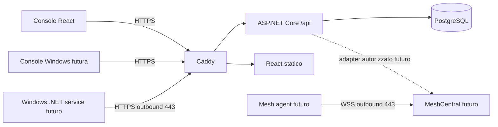

# Architettura e confini

OmniDesk è un RMM self-hosted single-tenant, multiutente. La milestone 1 implementa il piano di gestione, non un agente RMM completo.

Deployment aggiornato per il server indicato: Caddy termina TLS interno e pubblica solo 192.168.1.233:8085, con CA locale; Nginx esistente gestisce i certificati pubblici e 80/443. PostgreSQL e API non espongono porte host. Modalità alternativa Caddy diretto/Let’s Encrypt solo nell’overlay compose.direct.yaml. Certificati e chiavi Identity sono persistenti in volumi separati. API accetta solo X-Forwarded-Proto dalla subnet proxy dedicata (configurabile con OMNIDESK_PROXY_SUBNET, default 172.29.84.0/24), un solo hop; nessuna fiducia in X-Forwarded-For. Cookie sempre Secure. La rete backend PostgreSQL è interna. La subnet proxy è un confine di fiducia: non aggiungervi container estranei. Reverse proxy stessa origine, nessun CORS permissivo. Rate limit login per origine TCP (dietro Caddy condivisa: limite conservativo); lockout per account persistente.

ASP.NET Identity gestisce hash password, ruoli, security stamp, campi TOTP. Cookie autenticazione 8 ore, senza rinnovo sliding; validazione security stamp ogni minuto. Richieste mutanti richiedono antiforgery header X-CSRF-TOKEN; login/logout inclusi. Il client rinnova il token dopo login. TOTP predisposta nello schema Identity, disattivata: nessuna API consente attivazione finché setup, recovery e challenge non saranno implementati. Account TOTP-enabled vengono rifiutati dal login attuale.

PermissionService centralizza default deny: ruolo globale Identity oppure assegnazione esplicita per gruppo/dispositivo. Una concessione su gruppo copre i suoi dispositivi; non esistono deny o gruppi annidati in M1. view non implica controllo remoto. Le future integrazioni devono usare lo stesso controllo prima di emettere sessioni o comandi. Revoche permessi consultate dal DB a ogni richiesta.

Moduli: src/OmniDesk.Api (Data, Security, Endpoints), src/dashboard, modules/agent-windows, modules/console-windows, modules/remote-meshcentral. Le cartelle modules sono contratti progettuali, non implementazioni.

Rischi: prima di esposizione pubblica serve collaudo su Ubuntu pulito con DNS pubblico e TLS reale, backup/restore, revisione sicurezza e aggiornamento immagini. M1 non è una release pronta per gestire endpoint in produzione.

Fonti tecniche: [.NET lifecycle](https://dotnet.microsoft.com/en-us/platform/support/policy/dotnet-core), [Caddy automatic HTTPS](https://caddyserver.com/docs/automatic-https), [MeshCentral](https://docs.meshcentral.com/meshcentral/). Versioni major fissate in Compose; blocchi npm e migrazioni versionati. Per una release fissare digest immagini dopo collaudo e applicare patch supportate.

Riferimenti deployment: [Docker su Ubuntu](https://docs.docker.com/engine/install/ubuntu/), [ASP.NET Core dietro proxy](https://learn.microsoft.com/en-us/aspnet/core/host-and-deploy/proxy-load-balancer?view=aspnetcore-10.0).

Enrollment M2 (progettato): amministratore con permesso administration emette token casuale ad alta entropia, con ambito, TTL breve e singolo utilizzo. Il DB conserva soltanto hash del token; consumo atomico e generazione identità device in transazione. Agente verifica HTTPS, genera chiave locale protetta da Windows DPAPI/ACL e prova il possesso; credenziali dispositivo revocabili e ruotabili, distinte da sessioni umane. Niente password amministrative nell’MSI, credenziali in URL o bypass TLS. Rate limit e audit anche dei tentativi falliti. Il protocollo e il packaging saranno definiti/testati in M2.
