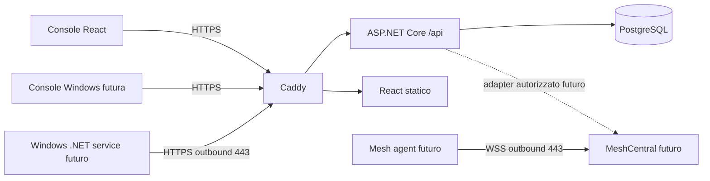

# Architettura e confini

OmniDesk è un RMM self-hosted single-tenant, multiutente. La milestone 1 implementa il piano di gestione, non un agente RMM completo.

Caddy termina TLS e richiede certificati Let's Encrypt; PostgreSQL e API non espongono porte host. Solo Caddy espone 80/443. Certificati e chiavi Identity sono persistenti in volumi separati. API non si fida degli header proxy per decisioni di sicurezza; cookie sempre Secure. Reverse proxy stessa origine, nessun CORS permissivo. Rate limit login per origine TCP (dietro Caddy condivisa: limite conservativo); lockout per account persistente.

ASP.NET Identity gestisce hash password, ruoli, security stamp, campi TOTP. Cookie autenticazione 8 ore, senza rinnovo sliding; validazione security stamp ogni minuto. Richieste mutanti richiedono antiforgery header X-CSRF-TOKEN; login/logout inclusi. Il client rinnova il token dopo login. TOTP predisposta nello schema Identity, disattivata: nessuna API consente attivazione finché setup, recovery e challenge non saranno implementati. Account TOTP-enabled vengono rifiutati dal login attuale.

PermissionService centralizza default deny: ruolo globale Identity oppure assegnazione esplicita per gruppo/dispositivo. Una concessione su gruppo copre i suoi dispositivi; non esistono deny o gruppi annidati in M1. view non implica controllo remoto. Le future integrazioni devono usare lo stesso controllo prima di emettere sessioni o comandi. Revoche permessi consultate dal DB a ogni richiesta.

Moduli: src/OmniDesk.Api (Data, Security, Endpoints), src/dashboard, modules/agent-windows, modules/console-windows, modules/remote-meshcentral. Le cartelle modules sono contratti progettuali, non implementazioni.

Rischi: prima di esposizione pubblica serve collaudo su Ubuntu pulito con DNS pubblico e TLS reale, backup/restore, revisione sicurezza e aggiornamento immagini. M1 non è una release pronta per gestire endpoint in produzione.

Fonti tecniche: [.NET lifecycle](https://dotnet.microsoft.com/en-us/platform/support/policy/dotnet-core), [Caddy automatic HTTPS](https://caddyserver.com/docs/automatic-https), [MeshCentral](https://docs.meshcentral.com/meshcentral/). Versioni major fissate in Compose; blocchi npm e migrazioni versionati. Per una release fissare digest immagini dopo collaudo e applicare patch supportate.
