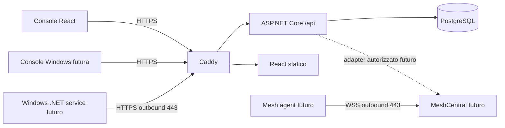
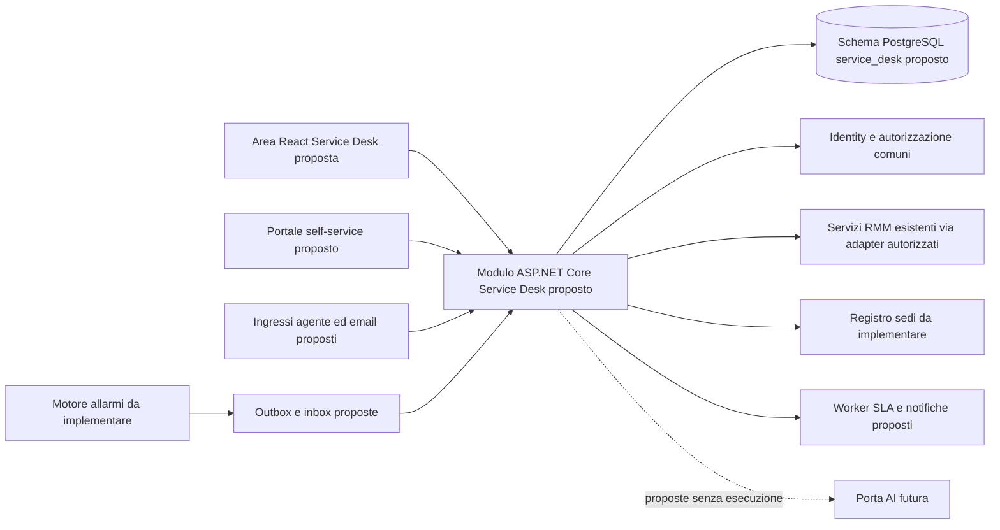
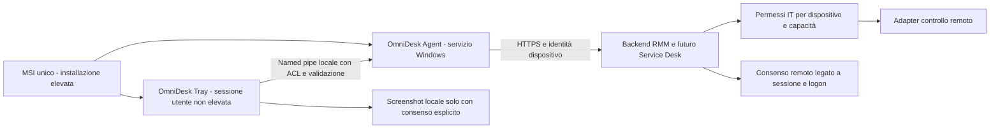

# Architettura e confini

OmniDesk è un RMM self-hosted single-tenant, multiutente. La milestone 1 implementa il piano di gestione, non un agente RMM completo.

Deployment aggiornato per il server indicato: Caddy termina TLS interno e pubblica solo 192.168.1.233:8085, con CA locale; Nginx esistente gestisce i certificati pubblici e 80/443. PostgreSQL e API non espongono porte host. Modalità alternativa Caddy diretto/Let’s Encrypt solo nell’overlay compose.direct.yaml. Certificati e chiavi Identity sono persistenti in volumi separati. API accetta solo X-Forwarded-Proto dalla subnet proxy dedicata (configurabile con OMNIDESK_PROXY_SUBNET, default 172.29.84.0/24), un solo hop; nessuna fiducia in X-Forwarded-For. Cookie sempre Secure. La rete backend PostgreSQL è interna. La subnet proxy è un confine di fiducia: non aggiungervi container estranei. Reverse proxy stessa origine, nessun CORS permissivo. Rate limit login per origine TCP (dietro Caddy condivisa: limite conservativo); lockout per account persistente.

ASP.NET Identity gestisce hash password, ruoli, security stamp, campi TOTP. Cookie autenticazione 8 ore, senza rinnovo sliding; validazione security stamp ogni minuto. Richieste mutanti richiedono antiforgery header X-CSRF-TOKEN; login/logout inclusi. Il client rinnova il token dopo login. TOTP predisposta nello schema Identity, disattivata: nessuna API consente attivazione finché setup, recovery e challenge non saranno implementati. Account TOTP-enabled vengono rifiutati dal login attuale.

PermissionService centralizza default deny: ruolo globale Identity oppure assegnazione esplicita per gruppo/dispositivo. Una concessione su gruppo copre i suoi dispositivi; non esistono deny o gruppi annidati in M1. view non implica controllo remoto. Le future integrazioni devono usare lo stesso controllo prima di emettere sessioni o comandi. Revoche permessi consultate dal DB a ogni richiesta.

Moduli: src/OmniDesk.Api (Data, Security, Endpoints), src/dashboard, modules/agent-windows, modules/console-windows, modules/remote-meshcentral. Le cartelle modules sono contratti progettuali, non implementazioni.

Rischi: prima di esposizione pubblica serve collaudo su Ubuntu pulito con DNS pubblico e TLS reale, backup/restore, revisione sicurezza e aggiornamento immagini. M1 non è una release pronta per gestire endpoint in produzione.

Fonti tecniche: [.NET lifecycle](https://dotnet.microsoft.com/en-us/platform/support/policy/dotnet-core), [Caddy automatic HTTPS](https://caddyserver.com/docs/automatic-https), [MeshCentral](https://docs.meshcentral.com/meshcentral/). Versioni major fissate in Compose; blocchi npm e migrazioni versionati. Per una release fissare digest immagini dopo collaudo e applicare patch supportate.

Riferimenti deployment: [Docker su Ubuntu](https://docs.docker.com/engine/install/ubuntu/), [ASP.NET Core dietro proxy](https://learn.microsoft.com/en-us/aspnet/core/host-and-deploy/proxy-load-balancer?view=aspnetcore-10.0).

Enrollment M2 (progettato): amministratore con permesso administration emette token casuale ad alta entropia, con ambito, TTL breve e singolo utilizzo. Il DB conserva soltanto hash del token; consumo atomico e generazione identità device in transazione. Agente verifica HTTPS, genera chiave locale protetta da Windows DPAPI/ACL e prova il possesso; credenziali dispositivo revocabili e ruotabili, distinte da sessioni umane. Niente password amministrative nell’MSI, credenziali in URL o bypass TLS. Rate limit e audit anche dei tentativi falliti. Il protocollo e il packaging saranno definiti/testati in M2.

## Estensione proposta: OmniDesk Service Desk

Questa sezione è progettuale e non cambia il perimetro delle milestone esistenti. Lo stato effettivo M2–M5 è riportato in [validation.md](validation.md); il diagramma iniziale descrive la baseline M1.

Il futuro modulo ASP.NET Core separato `OmniDesk.ServiceDesk` sarà ospitato inizialmente nell'API attuale, con dominio, servizi applicativi, adapter e DbContext propri nello schema PostgreSQL `service_desk`. Dashboard React e portale self-service useranno contratti distinti. Identity, autorizzazione e audit restano condivisi; nessuna duplicazione delle identità o accesso diretto alle credenziali dei motori remoti.

Ogni ticket avrà una sede e almeno un dispositivo; richieste incomplete rimarranno intake. Sedi e allarmi persistenti sono dipendenze future, non funzionalità già presenti. Il permesso sul ticket non concede capacità RMM: ogni azione esplicita ricontrolla la capacità sul dispositivo scelto. Automazioni e AI non eseguono comandi non autorizzati. Eventi versionati, outbox/inbox e worker con lease separano operazioni interattive e asincrone senza introdurre obbligatoriamente un broker o microservizi.

Specifiche: [Service Desk](service-desk.md), [schema proposto](service-desk-data-model.md), [fasi e dipendenze](roadmap.md#percorso-futuro-omnidesk-service-desk). Nessun nuovo deployment o codice viene introdotto da questa progettazione.

## Componenti Windows Agent e Tray

[Specifica tecnica Agent/Tray](windows-agent-tray.md): servizio .NET automatico indipendente dal logon e processo Tray non elevato per ogni sessione utente, installati da un unico MSI per-machine. La console IT Windows esistente è un'altra applicazione e non assume il ruolo della Tray.

Il servizio possiede credenziali protette da ACL/DPAPI o futuro Certificate Store; la Tray riceve solo operazioni IPC allowlist e non può arrestare, modificare o disinstallare il servizio. Recovery SCM, heartbeat/offline con audit e revoca server sono implementati nel sorgente 0.8.0; Setup e MSI sono compilati. La prova interattiva di installazione/rimozione resta da eseguire sul PC Windows pilota. Nessuna protezione assoluta contro amministratori locali o accesso fisico privilegiato è promessa.

Richieste assistenza associate dal server al dispositivo dell'agente; lettura ticket vincolata anche all'utente verificato. Named pipe locale per logon con controllo dell'identità effettiva, protezione da server contraffatti e limiti sui messaggi, senza proxy privilegiato generico. Screenshot acquisiti nella sessione utente dopo anteprima/conferma. L'autorizzazione IT e il consenso utente remoto sono controlli distinti, entrambi correlati alla sessione; la chiusura della Tray non arresta il servizio né abilita automaticamente accesso non presidiato.

La versione 0.8.0 include Agent e Tray nello stesso MSI. Stato di build e collaudo: [roadmap Windows](roadmap.md#percorso-futuro-windows-agent-e-tray).

L'autorizzazione remota è applicata dal backend al rilascio/consumo del grant e durante la sessione: `view`, `remote.control`, `terminal`, `files`, `updates` e `administration` restano separati negli ambiti global/group/device. Accesso unattended ed elevazione mantengono capacità esplicite e separate; la dismissione richiede la revoca server. La [matrice Windows](windows-agent-tray.md#matrice-di-autorizzazione-proposta) distingue permessi IT, consenso del logon destinatario e privilegi locali; nessun ticket o messaggio Tray concede implicitamente controllo remoto.

### Console RMM React e embedding MeshCentral

La scheda dispositivo React espone le sezioni RMM con stati distinti per dati
disponibili e capacità ancora assenti. Il desktop remoto usa la sessione share
temporanea emessa da `POST /api/devices/{id}/remote-sessions`; il backend verifica
capability, scope, mapping, policy e revoca prima di rilasciare il link. Il
frontend accetta esclusivamente URL HTTPS `/sharing` con scadenza futura e senza
credenziali nell'URL; per una risposta non valida tenta la revoca immediata.

L'iframe è cross-origin e `no-referrer`. `frame-src` dashboard e
`allowedFramingOrigins`/CSP MeshCentral ammettono solo gli origin OmniDesk
configurati. `allowLoginToken` non viene abilitato e token permanenti non entrano
nel browser. Il sandbox isola i contenuti e abilita le capacità necessarie alla
UI Mesh. La policy server Mesh continua a gestire consenso e comandi. Per la
same-origin policy, selezione monitor, qualità, scaling, tastiera e clipboard
restano i controlli nativi presenti in MeshCentral; React non manipola il DOM
remoto. Il load della pagina non prova l'attività dello stream. Processi, servizi
ed eventi Windows sono raccolti on-demand dall'Agent con permesso dedicato
`diagnostics.view`, coda e audit. La raccolta diagnostica resta in sola lettura;
il controllo servizi è una capability indipendente `services.manage`, e la
terminazione processi usa `processes.manage`; entrambe sono negate ai ruoli
Operator/Viewer predefiniti e rivalidate al claim del job. La UI richiede
conferma e l’Agent accetta solo start/stop/restart su nomi validi, rifiutando
servizi OmniDesk e un elenco di servizi Windows critici. Ricevute locali evitano
la riesecuzione automatica dopo interruzioni. La terminazione ricontrolla PID,
nome e timestamp d’avvio, rifiuta i processi OmniDesk e i processi Windows
critici; la self-test Windows collauda un `cmd.exe` temporaneo. I risultati sono
limitati; la verifica della candidata MSI 0.8.5 e delle azioni sul pilota resta aperta.

## Hardening account e lifecycle corrente

Oltre al validatore periodico Identity della baseline, lo stato account e il security stamp sono verificati sul DB a ogni richiesta cookie. Sospensione/riattivazione, ruoli globali e revoca sessioni web sono autorizzati e auditati sul server, con protezione dell'ultimo amministratore abilitato e serializzazione PostgreSQL. Il guard remoto persiste e ritenta la revoca in caso di perdita autorizzazione o sospensione; test con adapter fake, gate motore reale ancora aperto. Le richieste già in esecuzione non vengono retroattivamente annullate. Dettagli in [M5](milestone-5.md) e [API](api.md).

Backup locale e restore PostgreSQL isolato disponibili; ripristino completo app/chiavi e disaster recovery ancora da collaudare: [procedura e limiti](backup-restore.md).

## Sorgenti Windows 0.6.0 in lavorazione

Avviata l'implementazione Agent/Tray con processo UI asInvoker, stato heartbeat reale e pipe locale per logon, contratto read-only versionato e autenticazione tramite SID/SCM/owner. Il sorgente MSI installa entrambi i componenti e configura Run utente, recovery e DACL servizio. Nuovi progetti separati Windows.Ipc e Tray.Windows; nessuna dipendenza della dashboard o API dalle librerie Windows. **Non compilato o collaudato**, a causa dell'indisponibilità della revisione automatica necessaria ai comandi Docker; non pubblicato sul server. Ticket, screenshot e consenso remoto restano da implementare. [Stato dettagliato e gate](windows-agent-tray-implementation.md).

Per l’aggiornamento remoto Agent della 0.8.1, vedi [la roadmap e i gate Windows](roadmap.md#aggiornamento-remoto-agent-windows): autorizzazione globale `administration`, MSI della release verificata, hash controllato dal client, updater separato protetto in ProgramData e nessun riavvio automatico di Windows. SHA-256 non equivale a firma Authenticode; la nuova versione e il test MSI Windows devono passare prima del rilascio.
