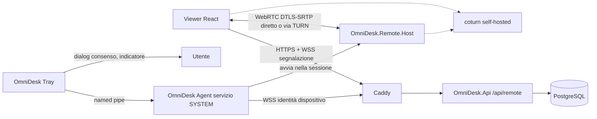

# Architettura: OmniDesk Remote (connessione remota integrata, ispirata a TeamViewer Remote)

Stato: **progettato**. Nulla di questo documento è compilato o testato, tranne `schema.sql`:
applicato il 2026-11-15 su PostgreSQL 16 usa e getta con tabelle esistenti
ridotte a stub; verificati indice unico del controllo attivo, check di stato,
policy consenso/unattended, ambito unico delle assegnazioni e durata massima
degli inviti. Non verificato contro il database reale né come migrazione EF.
Input: [recon.md](recon.md), [features.csv](features.csv). Data: 2026-11-15.

Obiettivo: sostituire il percorso attuale (client RustDesk esterno, adapter
MeshCentral bloccato da Defender) con una sessione remota **orchestrata da
OmniDesk dall'inizio alla fine**: autorizzazione, consenso, policy, azioni,
revoca, report e registrazione restano sul server OmniDesk; il flusso video e
l'input viaggiano su un trasporto standard.

## Decisione sul trasporto

| opzione | pro | contro | esito |
| --- | --- | --- | --- |
| MeshCentral (adapter esistente) | già integrato, revoca via API | `MeshService64.exe` in quarantena Defender sul pilota ([dossier](../docs/remote-engine-defender-review.md)) | scartato finché il rilevamento non è risolto |
| RustDesk OSS (client esterno attuale) | collegamento confermato dall'operatore | OmniDesk non vede né controlla stato, consenso, chiusura o revoca; l'API di gestione sessioni è nella versione Pro | resta **ripiego** fino alla parità |
| **Nativo: host OmniDesk + WebRTC** | viewer nel browser senza installazione; DTLS-SRTP standard (nessuna crittografia personalizzata); controllo completo del ciclo di vita | cattura, codec, input e desktop protetto da scrivere; rischio Defender anche sul nostro binario | **scelto**, con spike e criterio di uscita (M-R0) |

Se lo spike M-R0 fallisce i criteri, si ripiega su: RustDesk gestito
dall'Agent (password monouso impostata dall'Agent per sessione, chiusura del
processo alla revoca). Schema e API qui sotto restano validi in entrambi i
casi: il campo `Engine` distingue `native` e `rustdesk`.

## Stack

Si resta sullo stack OmniDesk esistente; nessun servizio gestito esterno
(prodotto self-hosted, single-tenant).

| layer | choice | why |
| --- | --- | --- |
| API | ASP.NET Core .NET 10 esistente (`OmniDesk.Api`), nuovo gruppo `/api/remote` | autorizzazione, audit e Identity già lì; un solo processo |
| database | PostgreSQL esistente, migrazioni EF Core versionate | un solo database; niente `EnsureCreated` |
| auth | ASP.NET Identity esistente (cookie HttpOnly/Secure/SameSite, antiforgery) | requisito AGENTS.md |
| autorizzazione | `PermissionService` (default deny, ambiti global/group/site/device) | controllo per ogni query, **non** RLS |
| viewer tecnico | dashboard React/TypeScript esistente, pagina sessione con `RTCPeerConnection` nativo del browser | nessuna installazione per il tecnico; funziona anche nella console WebView2 |
| segnalazione | WebSocket ASP.NET Core (`/api/remote/signal`) per browser e host | il polling a lease dell'Agent è troppo lento per offer/answer/ICE |
| host endpoint | nuovo `OmniDesk.Remote.Host` (.NET 10, Windows), avviato dal servizio Agent nella sessione utente o sul desktop Winlogon | il servizio SYSTEM esiste già; la Tray non è elevata e non deve diventarlo |
| cattura | DXGI Desktop Duplication | API Windows standard, multi-monitor |
| codec | H.264 via Media Foundation (hardware se presente), VP8 come ripiego | decodifica nativa in tutti i browser |
| stack WebRTC lato host | **da decidere nello spike**: SIPSorcery (C#, BSD-3) oppure libwebrtc nativo | entrambe librerie esistenti; nessuna crittografia scritta da noi |
| NAT / relay | coturn self-hosted, credenziali TURN temporanee (HMAC, schema "TURN REST API") | sostituisce la rete di relay TeamViewer; nessuna credenziale statica |
| input | `SendInput` nel processo host | standard Win32 |
| registrazioni | file su volume dedicato del server, retention configurabile | backup NAS già previsto |
| jobs | `BackgroundService` esistenti (`RemoteSessionGuard` esteso) | stesso modello del guard attuale |
| hosting | Compose esistente + servizio `coturn` opzionale (`compose.remote.yaml`) | setup standard invariato senza opt-in |
| email / pagamenti | non servono | uso interno |

Porte nuove da pubblicare sul router (decisione dell'amministratore, l'installer
non tocca firewall): UDP/TCP 3478 per TURN, più l'intervallo relay UDP scelto.
TURN su TLS 443 non è possibile sullo stesso IP di Caddy senza un
multiplexer: per ora non previsto.

## Componenti

- Il server **non vede il flusso video**: media e data channel sono cifrati
  tra browser e host. Il server autorizza, segnala, registra eventi e può
  chiudere la sessione ordinando all'host di terminare.
- L'host accetta solo offer ricevute dal canale Agent autenticato con
  l'identità dispositivo, mai connessioni in ingresso.
- Revoca: il guard esistente ricontrolla permessi, credenziale dispositivo e
  versione policy ogni 10 s; per `native` invia `terminate` all'host via
  Agent e attende la conferma prima di marcare `revoked`.

## Permessi

Esistenti: `view`, `remote.control`, `files`, `administration`.
Nuovi (migrazione con seed `RolePermissions`, Operator li riceve tranne
`remote.recordings.view`):

| permesso | concede |
| --- | --- |
| `remote.view` | sessione in sola visione (nessun input) |
| `remote.control` | controllo con input (esistente) |
| `remote.unattended` | connettersi senza consenso, solo se anche la policy lo consente |
| `files` | trasferimento file in sessione (esistente) |
| `remote.recordings.view` | vedere/scaricare registrazioni |
| `administration` | policy remote, report completi (esistente) |

Una sessione richiede **sempre** il permesso sull'ambito del dispositivo *e*
la policy del dispositivo; nessuno dei due da solo basta.

## Schema

Tabelle: **10** (1 modificata, 9 nuove). Access rules: controlli nel data layer
tramite `PermissionService`, una verifica per ogni endpoint e per ogni
transizione di stato. SQL completo in [schema.sql](schema.sql): è il
riferimento per la revisione; la migrazione reale va generata con EF Core
(`dotnet ef migrations add RemoteNative`) e confrontata con questo file.

| tabella | scopo | note |
| --- | --- | --- |
| `RemoteSessions` (modificata) | una sessione remota | + `Engine`, `Mode`, `ConsentState`, `StartedAt`, `LastHeartbeatAt`, `EndReason`, `TicketId`, `InvitationId`; nuovi stati con check |
| `RemotePolicies` | regole remote tipizzate | colonne, non jsonb: ogni regola validabile |
| `RemotePolicyAssignments` | policy su dispositivo o gruppo | esattamente un ambito; precedenza device > group > default |
| `RemoteSupportInvitations` | codice/link per sessione assistita | solo hash di codice e token, scadenza, monouso |
| `RemoteCodeAttempts` | backoff sui codici errati | per origine (hash) e per invito |
| `RemoteSessionParticipants` | tecnici in sessione | owner + invitati, ognuno con permesso ricontrollato |
| `RemoteSessionEvents` | azioni in sessione | tipo + metadati, **mai** contenuti (appunti, testo chat, tasti) |
| `RemoteFileTransfers` | audit dei trasferimenti | nome, dimensione, hash, direzione; il contenuto non passa dal server |
| `RemoteRecordings` | registrazioni | percorso, hash, dimensione, retention |
| `RemoteWakeRequests` | Wake-on-LAN | richiesta eseguita da un altro Agent della stessa LAN |

La fetta verticale ne usa 2 (`RemoteSessions`, `RemoteSessionEvents`).

Vincoli duri dalla recon:
- **una sola sessione con controllo attivo per dispositivo e monitor-desktop**:
  indice unico parziale su `RemoteSessions (DeviceId) where State in
  ('connecting','active') and Capability = 'remote.control'`; altri tecnici
  entrano come partecipanti, non come seconda sessione.
- **un invito si consuma una volta**: `ConsumedAt` impostato con update
  condizionale (`where ConsumedAt is null and ExpiresAt > now()`).
- **transizioni di stato atomiche**: ogni passaggio è un `ExecuteUpdate` con
  lo stato di partenza nel `where` (stesso schema del guard attuale), mai
  read-modify-write.
- **policy assegnata a un solo ambito**: check `num_nonnulls(DeviceId, GroupId) = 1`
  come `CK_ScopeGrant_OneScope`.

Stati di `RemoteSessions.State`:
`pending → consent_pending → connecting → active → ended`
con uscite `declined`, `expired`, `failed`, `revocation_pending → revoked`.

## API

Tutte le mutazioni richiedono cookie + header antiforgery `X-CSRF-TOKEN`.
Le rotte `agent` usano l'identità dispositivo esistente (asserzione firmata),
mai il cookie.

### F03 Connessione non assistita da elenco (fetta verticale)

| method path | does | who | input | output | flow |
| --- | --- | --- | --- | --- | --- |
| GET `/api/remote/devices/{id}/availability` | online, host pronto, policy effettiva, motivi di blocco | `view` sul device | — | `{online, engine, policy, canControl, canUnattended, reasons[]}` | F03 |
| POST `/api/remote/devices/{id}/sessions` | crea sessione; decide se serve consenso | `remote.control` o `remote.view` sul device | `{capability, mode, ticketId?}` | `{sessionId, state, signalTicket}` | F03, F01 |
| GET `/api/remote/sessions/{sid}` | stato sessione | owner, partecipante o `administration` | — | sessione | tutti |
| POST `/api/remote/sessions/{sid}/end` | chiude dal tecnico | owner o `administration` | `{reason}` | `{state}` | F06 |
| POST `/api/remote/sessions/{sid}/turn-credentials` | credenziali TURN temporanee (TTL breve) | partecipante attivo | — | `{urls, username, credential, ttl}` | F03 |
| WS `/api/remote/signal` | offer/answer/ICE tra browser e host | primo messaggio = `signalTicket` monouso, legato a utente+sessione | messaggi JSON tipizzati | messaggi JSON | F03 |

### Agent e host

| method path | does | who | input | output | flow |
| --- | --- | --- | --- | --- | --- |
| WS `/api/agent/remote` | canale persistente: `start`, `terminate`, `consent.request`, `signal` | identità dispositivo valida, non revocata | messaggi JSON | messaggi JSON | F01–F06 |
| POST `/api/agent/remote/sessions/{sid}/consent` | esito del dialog Tray | identità dispositivo | `{decision, windowsUser}` | `{state}` | F01 |
| POST `/api/agent/remote/sessions/{sid}/heartbeat` | host vivo, desktop corrente | identità dispositivo | `{desktop, monitors}` | `{continue: bool}` | F05 |
| POST `/api/agent/remote/sessions/{sid}/ended` | chiusura lato utente/host | identità dispositivo | `{reason}` | — | F06 |
| POST `/api/agent/remote/sessions/{sid}/events` | eventi in sessione (riavvio, blocco, file) | identità dispositivo | `[{type, at, meta}]` | — | F05 |

### F01 Sessione assistita con codice/link

| method path | does | who | input | output | flow |
| --- | --- | --- | --- | --- | --- |
| POST `/api/remote/invitations` | crea invito con nome, scadenza | `remote.control` (global o sul gruppo destinatario) | `{name, expiresInMinutes, groupId?}` | `{id, code, link}` mostrati **una volta** | F01 |
| GET `/api/remote/invitations` | inviti propri aperti | autore o `administration` | — | lista (senza codici) | F01 |
| DELETE `/api/remote/invitations/{id}` | revoca invito | autore o `administration` | — | — | F01 |
| POST `/api/agent/remote/invitations/join` | la Tray inserisce il codice; lega invito al device | identità dispositivo + backoff | `{code}` | `{invitationId, technicianName}` | F01 |
| POST `/api/remote/invitations/{id}/accept-join` | il tecnico entra dalla sala d'attesa → crea sessione `consent_pending` | autore | — | `{sessionId}` | F01 |

### F05 Azioni in sessione

Le azioni viaggiano sul data channel WebRTC (bassa latenza), ma quelle con
effetto sul sistema passano anche dal server per autorizzazione e audit:

| method path | does | who | input | output | flow |
| --- | --- | --- | --- | --- | --- |
| POST `/api/remote/sessions/{sid}/actions` | `reboot`, `reboot_safe`, `lock`, `logoff`, `black_screen`, `disable_input`, `leave_note` | owner con `remote.control`; policy consente | `{action, args}` | `{accepted}` | F05 |
| POST `/api/remote/sessions/{sid}/participants` | invita un altro tecnico | owner | `{userId}` | partecipante | F05 |
| DELETE `/api/remote/sessions/{sid}/participants/{uid}` | rimuove | owner o `administration` | — | — | F05 |
| POST `/api/remote/sessions/{sid}/file-transfers` | registra e autorizza un trasferimento prima che inizi | `files` sul device; policy consente | `{direction, name, size}` | `{transferId, maxBytes}` | F05 |
| PATCH `/api/remote/file-transfers/{tid}` | esito, hash | owner | `{state, sha256}` | — | F05 |
| POST `/api/remote/sessions/{sid}/recordings` | avvia upload registrazione | owner; obbligatorio se policy `AutoRecord` | — | `{recordingId, uploadUrl}` | F05 |
| PUT `/api/remote/recordings/{rid}/chunks/{n}` | chunk registrazione | owner | binario | — | F05 |

### F06–F08 Report, policy, WoL

| method path | does | who | input | output | flow |
| --- | --- | --- | --- | --- | --- |
| GET `/api/remote/reports/sessions` | report connessioni filtrabile | `administration`, oppure solo le proprie | `user, device, group, from, to, state` | lista paginata | F08 |
| GET `/api/remote/reports/sessions.csv` | export CSV, orari UTC | come sopra | stessi filtri | CSV | F08 |
| GET `/api/remote/sessions/{sid}/events` | timeline della sessione | `administration` o owner | — | eventi | F08 |
| GET `/api/remote/recordings/{rid}` | download | `remote.recordings.view` sul device | — | file | F08 |
| GET/POST/PUT/DELETE `/api/admin/remote/policies[/{id}]` | CRUD policy | `administration` | policy | policy | — |
| PUT/DELETE `/api/admin/remote/policies/{id}/assignments` | assegna a device/gruppo | `administration` | `{deviceId? groupId?}` | — | — |
| POST `/api/remote/devices/{id}/wake` | Wake-on-LAN tramite un altro Agent online nella stessa sede | `remote.control` sul device | — | `{requestId, relayDeviceId}` | F07 |

Rotte: **34** (27 HTTP utente/admin, 5 HTTP agent, 2 WebSocket).

Webhooks in/out: nessuno.

Jobs (`RemoteSessionGuard` esteso, ogni 10 s):
- revoca: permesso, credenziale dispositivo, versione policy (già esistente) +
  `terminate` all'host per `native`;
- `consent_pending` oltre 60 s → `expired`; `connecting` oltre 30 s → `failed`;
- `active` senza heartbeat da 30 s → `ended` con `EndReason = host_lost`;
- `ExpiresAt` superato → chiusura;
- inviti scaduti → marcati, codici non più validi.

Job giornaliero: retention registrazioni (default `0` = disattivata, come le
altre retention OmniDesk) e pulizia `RemoteCodeAttempts` vecchi.

## Host endpoint: come gira su Windows

1. Il servizio Agent (SYSTEM) riceve `start` sul canale WebSocket.
2. Individua la sessione console attiva (`WTSGetActiveConsoleSessionId`).
   Se c'è un utente: avvia `OmniDesk.Remote.Host` in quella sessione con il
   token di sessione, desktop `winsta0\default`. Se non c'è un utente o è
   in primo piano il desktop protetto (login, UAC): host SYSTEM in quella
   sessione sul desktop `winsta0\winlogon`. L'host segue i cambi di desktop.
3. Se la policy richiede consenso: la Tray mostra il dialog
   (Consenti / Rifiuta, nome tecnico, cosa potrà fare). Senza Tray in
   esecuzione o senza utente collegato: consenso impossibile → solo
   `remote.unattended` con policy che lo consente.
4. Durante la sessione la Tray mostra un **indicatore sempre visibile**
   (tecnico, registrazione attiva, pulsante "Termina"). Non disattivabile da
   policy.
5. Riavvio: l'host registra `reboot_pending`; dopo il riavvio l'Agent
   riprende la stessa sessione se non è scaduta e i permessi sono ancora validi.

## The parts that bite

- **Desktop protetto e cambi sessione**: login, UAC, cambio utente rapido, RDP
  attivo sulla stessa macchina. L'host deve rilevare e seguire il desktop di
  input, altrimenti schermo nero o input perso. È la prima causa di "non
  funziona" nei prodotti simili.
- **Defender e firma**: un binario non firmato che cattura schermo e inietta
  input è esattamente ciò che i motori euristici segnalano. Senza firma
  Authenticode (grant ancora in attesa) il rischio quarantena è alto. Lo
  spike va provato sul PC pilota con Defender attivo, **senza** esclusioni.
- **NAT e porte**: senza TURN raggiungibile, le sessioni fuori LAN falliscono.
  Le porte sul router sono una decisione dell'amministratore.
- **Latenza e banda**: bitrate adattivo, frame rate variabile, regione
  modificata. Obiettivi proposti per lo spike: 1080p ≥ 15 fps e input < 150 ms
  in LAN; misurarli, non dichiararli.
- **Multi-monitor e DPI**: coordinate mouse sbagliate con scaling diverso tra
  monitor; layout tastiera diversi tra tecnico e PC (modalità tastiera
  diretta vs. caratteri).
- **Race condition**: consenso che arriva dopo la scadenza, doppio clic su
  Connect, due tecnici sullo stesso PC, revoca durante `connecting`. Tutto con
  update condizionali e indice unico parziale.
- **Idempotenza**: messaggi Agent ripetuti dopo riconnessione WebSocket
  (eventi con `ClientEventId` unico; `ended` ripetuto non è errore).
- **Limiti file**: dimensione massima per trasferimento in policy; il server
  non riceve il contenuto, ma registra nome, dimensione e hash.
- **Appunti e chat**: possono contenere password. Mai salvati né in audit né
  negli eventi; solo il fatto che sono avvenuti.
- **Registrazione forzata**: registrata dal browser del tecnico e caricata a
  chunk. Se la policy la impone e l'upload si ferma per 30 s, la sessione
  viene chiusa. Un tecnico con accesso al proprio browser può comunque
  manomettere il file: è un limite dichiarato, non una garanzia forense.
- **Privacy / GDPR**: indicatore visibile, consenso registrato con utente
  Windows e ora, retention registrazioni configurata e documentata,
  informativa per gli utenti.
- **Fusi orari**: tutto `timestamptz` in UTC; CSV in UTC come TeamViewer.
- **Realtime**: WebSocket dietro Caddy (supportato nativamente), timeout e
  keep-alive da configurare.
- **Offline**: PC offline → nessuna sessione; Wake-on-LAN solo se un altro
  Agent della stessa sede è online.

## Build order

### M-R0 Spike trasporto (decisione)
Host minimo su PC pilota: cattura monitor primario, H.264, WebRTC verso una
pagina di prova, input mouse/tastiera, in LAN e via coturn.
Criteri di uscita: obiettivi di latenza sopra misurati e registrati in
`docs/validation.md`; Defender attivo **senza** quarantena; scelta tra
SIPSorcery e libwebrtc motivata. Se falliscono: ripiego RustDesk gestito.
Nessuna tabella, nessuna rotta di produzione.

### M-R1 Fetta verticale (F03, F06)
Il tecnico apre un PC gestito dall'elenco, controlla lo schermo, chiude, la
sessione compare nel report.
- Schermate: S08, S09 (solo monitor primario, nessuna toolbar), S18 (lista semplice)
- Tabelle: `RemoteSessions` (modificata), `RemoteSessionEvents`
- Rotte: availability, POST sessions, GET session, end, turn-credentials,
  WS signal, WS agent, heartbeat, ended, reports/sessions
- Test: autorizzazione (utente senza `remote.control` → 403; utente di un
  altro gruppo → 404), transizioni di stato, guard di revoca con `native`.

### M-R2 Must-have
Consenso via Tray (S06) e policy (S17) con `RemotePolicies` e assignments;
desktop protetto e Ctrl+Alt+Del; multi-monitor; riavvio con riconnessione;
blocco a fine sessione; appunti; trasferimento file (S10, `RemoteFileTransfers`);
indicatore utente; revoca che chiude la sessione aperta; backoff
(`RemoteCodeAttempts`); report con filtri e CSV; info sistema (riuso inventario).

### M-R3 Should-have
Inviti con codice/link e sala d'attesa (S02, S03, S05, `RemoteSupportInvitations`);
chat (S12); partecipanti (`RemoteSessionParticipants`); qualità e scala; sessioni
in tab; schermo nero; disabilita input; screenshot; registrazione manuale e
forzata (`RemoteRecordings`); commento sessione e collegamento ticket;
Wake-on-LAN (S19, `RemoteWakeRequests`); installazione Agent da sessione
assistita (richiede MSI firmato).

### M-R4 Could-have
Risoluzione remota, sfondo nascosto, cursore remoto, tastiera diretta, nota
lasciata, file box, audio remoto, inverti ruoli, script (riuso API terminale).

### M-R5 Sostituzione
`/replica-diff` sulla matrice; quando tutti i must-have sono `yes`, disattivare
il percorso RustDesk nella console (non eliminarlo finché il collaudo sul
pilota non è registrato), aggiornare roadmap, `completion-status.md` e
istruzioni operative.

### Fix da replica-entrepreneur
Non ancora eseguito.
