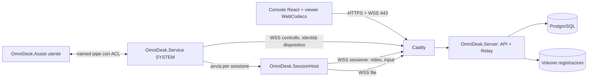

# Architettura: OmniDesk (nuovo) — solo connessione remota, trasporto proprio

Stato: **progettato**. Nessun codice esiste ancora. Data: 2026-11-15.
Input: [recon.md](recon.md), [features.csv](features.csv).

## Decisioni dell'utente (2026-11-15)

1. OmniDesk diventa **solo** il prodotto di connessione remota (ambito della
   recon: avvio sessione, consenso, sessione, file, chiusura, sicurezza,
   report, registrazione, Wake-on-LAN).
2. **Repository nuovo da zero**: nessun codice dell'OmniDesk attuale viene
   riusato. L'OmniDesk attuale resta com'è finché il nuovo non è collaudato;
   nessun dato viene migrato.
3. **Trasporto ex novo**: protocollo OmniDesk scritto da noi su WebSocket
   TLS 1.3, attraverso un relay OmniDesk sul server. Niente RustDesk,
   MeshCentral, WebRTC o coturn.

Le regole di [AGENTS.md](../AGENTS.md) valgono anche per il nuovo repository e
vanno copiate al suo avvio: autorizzazione server default deny, Identity,
niente crittografia personalizzata, migrazioni versionate, nessun segreto nel
repository, setup senza modifiche a servizi di sistema senza opt-in.

## Stack

Stessa famiglia tecnologica già nota, ripartendo da zero.

| layer | choice | why |
| --- | --- | --- |
| server | ASP.NET Core .NET 10, un solo processo `OmniDesk.Server` (API + relay) | una sola cosa da installare; il relay è un endpoint WebSocket di Kestrel |
| database | PostgreSQL, migrazioni EF Core versionate | un solo database, già noto |
| auth tecnici | ASP.NET Identity, cookie HttpOnly/Secure/SameSite, antiforgery, lockout; TOTP opzionale disattivata per default | requisito AGENTS.md |
| autorizzazione | servizio unico `Authorizer` con permessi per ambito global/group/device | controllo per ogni rotta e per ogni accoppiamento sul relay; niente RLS |
| console tecnico | React + TypeScript + Vite | elenco dispositivi, amministrazione, viewer |
| viewer | WebCodecs `VideoDecoder` (H.264) + `<canvas>`, WebSocket binario | decodifica hardware nel browser, nessuna installazione per il tecnico |
| PC: servizio | `OmniDesk.Service` .NET 10, servizio Windows SYSTEM | identità dispositivo, canale di controllo, avvio degli host |
| PC: host di sessione | `OmniDesk.SessionHost` .NET 10, un processo per sessione nella sessione Windows di destinazione | cattura, codifica, input, appunti, file |
| PC: interfaccia utente | `OmniDesk.Assist` WPF non elevato, icona di notifica | consenso, indicatore di sessione, codice di assistenza, chat |
| cattura | DXGI Desktop Duplication | API Windows standard, multi-monitor, cursore separato |
| codec | H.264 via Media Foundation (MFT hardware, poi software) | nessuna dipendenza nativa da distribuire; vedi rischio edizioni N |
| TLS | Caddy (Let's Encrypt), TLS 1.3, inoltro WebSocket a Kestrel | già sperimentato; nessuna porta nuova oltre 443 |
| firma | Authenticode su tutti gli eseguibili Windows | senza firma il rischio quarantena Defender è alto |
| installer | MSI per-machine (WiX), una sola installazione con servizio + host + Assist | come l'attuale, ripensato |
| deploy | Docker Compose: `server`, `postgres`, `caddy` | setup con opt-in per Docker, come oggi |
| email, pagamenti, job esterni | non servono | uso interno |

## Componenti

Tutto il traffico va **in uscita** dal PC verso la porta 443 del server.
Nessuna connessione in ingresso sul PC, nessuna porta nuova sul router.

## Il protocollo OmniDesk (ODP) v1

Specifica da scrivere in `docs/protocol.md` del nuovo repository, con test di
compatibilità. Qui le scelte.

### Connessioni

| connessione | da → a | autenticazione | contenuto |
| --- | --- | --- | --- |
| controllo | Service → `wss://…/relay/device` | asserzione firmata con la chiave del dispositivo (ES256), nonce dal server | presenza, `session.start`, `session.terminate`, `consent.request`, `wake.send`, configurazione policy |
| sessione host | SessionHost → `wss://…/relay/session` | primo messaggio: ticket di sessione monouso ricevuto via controllo | video, cursore, input, appunti, chat, azioni |
| sessione viewer | browser → `wss://…/relay/session` | cookie Identity + primo messaggio: ticket monouso ottenuto con POST antiforgery | come sopra |
| file host / viewer | → `wss://…/relay/files` | ticket monouso separato | trasferimento file |

I file usano una connessione separata perché su un'unica connessione TCP un
file grande bloccherebbe i frame video (head-of-line blocking).

I ticket non vanno mai nell'URL: viaggiano nel primo messaggio, scadono in
30 s, il server ne conserva solo l'hash e li consuma con un update
condizionale.

### Formato dei messaggi

Messaggi WebSocket binari. Intestazione fissa di 12 byte, little endian:

| campo | byte | note |
| --- | --- | --- |
| `version` | 1 | `1` |
| `type` | 1 | vedi tabella |
| `flags` | 2 | es. `KEYFRAME`, `LAST_CHUNK` |
| `seq` | 4 | contatore per direzione, per ack e diagnostica |
| `length` | 4 | lunghezza payload; massimo per tipo, oltre → chiusura |

Payload: binario per video e file; JSON UTF-8 piccolo e con schema per i
messaggi di controllo. Un tipo sconosciuto chiude la connessione con codice
`4400`. La versione viene negoziata con `HELLO`/`CAPS`.

| type | direzione | scopo |
| --- | --- | --- |
| `HELLO` / `CAPS` | entrambe | versione, codec, monitor, funzioni consentite dalla policy |
| `VIDEO_CONFIG` | host → viewer | profilo H.264, risoluzione, monitor |
| `VIDEO_FRAME` | host → viewer | unità H.264 Annex B, timestamp, flag keyframe |
| `FRAME_ACK` | viewer → host | ultimo `seq` decodificato: controllo di flusso |
| `KEYFRAME_REQUEST` | viewer → host | dopo perdita o cambio monitor |
| `CURSOR_SHAPE` / `CURSOR_POS` | host → viewer | cursore disegnato dal browser: latenza percepita minore |
| `INPUT_MOUSE` | viewer → host | posizione normalizzata 0–65535 sul monitor, tasti, rotella |
| `INPUT_KEY` | viewer → host | scancode (da `KeyboardEvent.code`), su/giù, extended |
| `INPUT_TEXT` | viewer → host | testo Unicode (incolla come digitazione) |
| `CLIPBOARD` | entrambe | testo, solo se la policy lo consente in quella direzione |
| `MONITORS` / `MONITOR_SELECT` | entrambe | elenco e scelta monitor |
| `QUALITY` | viewer → host | auto / velocità / qualità, frame rate massimo |
| `ACTION` / `ACTION_RESULT` | entrambe | Ctrl+Alt+Del, blocco, schermo nero, disabilita input… (autorizzate dal server, vedi sotto) |
| `CHAT` | entrambe | testo, inoltrato dal relay, non salvato |
| `FILE_OFFER` / `FILE_ACCEPT` / `FILE_CHUNK` / `FILE_ACK` / `FILE_DONE` / `FILE_CANCEL` | entrambe, connessione file | chunk da 256 KiB, hash SHA-256 finale |
| `PING` / `PONG` | entrambe | RTT ogni 2 s |
| `STATE` | relay → entrambi | `paired`, `peer_lost`, `paused_consent`, `terminating` |
| `BYE` | entrambe | chiusura con motivo |

### Video e controllo di flusso

- H.264 Constrained Baseline/Main, **niente B-frame**, modalità low latency
  dell'encoder, GOP lungo e keyframe a richiesta.
- Al massimo 3 frame non confermati in volo; oltre, l'host scarta i frame
  non-key successivi e codifica il successivo quando arriva un ack.
- Bitrate adattivo da RTT e ritardo degli ack; risoluzione ridotta in
  modalità "velocità".
- Solo le regioni cambiate fanno lavorare l'encoder (Desktop Duplication
  fornisce i dirty rect); a schermo fermo nessun frame.

### Cosa fa il relay

- Accoppia una connessione host e una o più viewer della stessa sessione,
  dopo aver verificato ticket, permesso, policy e stato sessione.
- Inoltra i messaggi **senza decodificarli**, tranne: limiti di dimensione per
  tipo, scarto di `INPUT_*` dai partecipanti in sola visione, scarto di
  `CLIPBOARD` contro policy, inoltro di `ACTION` solo se approvata dalla rotta
  HTTP corrispondente.
- Se la sessione va registrata, scrive i `VIDEO_FRAME` su disco con il loro
  timestamp (vedi registrazioni).
- Chiude entrambi i lati alla revoca, alla scadenza o al `BYE`.

### Sicurezza del trasporto

- Cifratura: **TLS 1.3 tra ogni lato e il server** (Caddy). Nessun algoritmo
  scritto da noi.
- Il server vede il flusso in chiaro dopo TLS: è un server vostro,
  single-tenant, e questo rende possibili registrazione forzata e policy
  applicate dal relay. Non c'è cifratura end-to-end: è un limite dichiarato.
- Il PC apre sempre la connessione e verifica il certificato del server con
  la catena di sistema; nessun bypass della verifica TLS.
- Il dispositivo si autentica con una chiave privata generata alla
  registrazione e protetta da DPAPI macchina e ACL; il server conserva solo
  la chiave pubblica.

## Sul PC Windows

1. **Registrazione**: l'amministratore emette un token monouso (solo l'hash
   nel DB, scadenza, revoca). L'MSI o il primo avvio lo consuma, genera la
   chiave del dispositivo e registra la chiave pubblica.
2. **Presenza**: il Service tiene aperta la connessione di controllo; il server
   segna online/offline con heartbeat ogni 15 s.
3. **Avvio sessione**: il Service riceve `session.start` con il ticket; trova
   la sessione Windows console attiva (o quella indicata) e avvia
   SessionHost come SYSTEM in quella sessione, sul desktop di input corrente.
   L'host segue i cambi tra `Default` e `Winlogon` (login, UAC, blocco).
4. **Consenso**: se la policy lo richiede, il Service chiede ad Assist (pipe)
   di mostrare il dialog: nome tecnico, cosa potrà fare, Consenti / Rifiuta,
   timeout. Senza utente collegato il consenso è impossibile: passa solo
   l'accesso non assistito consentito da permesso **e** policy.
5. **Indicatore**: durante la sessione Assist mostra una barra sempre visibile
   (tecnico, registrazione attiva, pulsante Termina). Non disattivabile.
6. **Ctrl+Alt+Del**: `SendSAS` richiede la policy Windows
   `SoftwareSASGeneration`. L'MSI la imposta **solo** con opzione esplicita
   dell'amministratore; senza, la funzione è nascosta.
7. **Riavvio**: il Service segna la sessione `reboot_pending`, al riavvio
   riapre la stessa sessione se non è scaduta e i permessi sono ancora validi.

## Permessi

| permesso | concede |
| --- | --- |
| `devices.view` | vedere dispositivi e stato nell'ambito |
| `remote.view` | sessione in sola visione |
| `remote.control` | sessione con input e azioni consentite dalla policy |
| `remote.unattended` | sessione senza consenso, se anche la policy lo consente |
| `files` | trasferimento file |
| `recordings.view` | vedere e scaricare registrazioni |
| `administration` | utenti, gruppi, registrazione dispositivi, policy, report completi |

Ruoli iniziali: Administrator (tutto), Technician (tutto tranne
`administration` e `recordings.view`), Viewer (`devices.view`, `remote.view`).
Ambiti: global, group, device. Default deny.

## Schema

Tabelle: **19** applicative più le tabelle ASP.NET Identity. Access rules:
controlli nel data layer (`Authorizer`), una verifica per rotta, per
accoppiamento sul relay e ogni 10 s per le sessioni aperte. SQL completo in
[schema.sql](schema.sql); la migrazione reale sarà generata con EF Core e
confrontata con il file.

Verifica del 2026-11-15, PostgreSQL 16 usa e getta con `AspNetUsers` e
`AspNetRoles` ridotte a stub: lo schema si applica senza errori (19 tabelle).
Respinti come previsto: secondo controllo attivo sullo stesso PC (mentre una
sessione in sola visione in parallelo passa), modalità invito senza invito,
sessione chiusa senza motivo, ticket viewer senza utente, ticket di 10 minuti,
grant su due ambiti, permesso sconosciuto, policy senza consenso né accesso
non assistito, cancellazione di un dispositivo con storico, due chiavi attive
per lo stesso dispositivo. Non verificato come migrazione EF né con dati reali.

| area | tabelle |
| --- | --- |
| permessi | `RolePermissions`, `ScopeGrants` |
| dispositivi | `DeviceGroups`, `Devices`, `EnrollmentTokens`, `DeviceKeys`, `DevicePresence` |
| policy | `Policies`, `PolicyAssignments` |
| sessioni | `Sessions`, `SessionTickets`, `SessionParticipants`, `SessionEvents`, `FileTransfers`, `Recordings` |
| assistenza | `Invitations`, `CodeAttempts` |
| altro | `WakeRequests`, `AuditEvents` |

Vincoli duri:
- un solo controllo attivo per dispositivo: indice unico parziale su
  `Sessions (DeviceId)` negli stati `connecting`/`active` con capability
  `remote.control`; altri tecnici entrano come partecipanti;
- ticket e inviti monouso: solo hash, consumo con update condizionale;
- transizioni di stato solo con update condizionale sullo stato di partenza;
- assegnazione policy e grant su un solo ambito (`num_nonnulls(...) = 1`);
- una policy senza consenso deve consentire l'accesso non assistito;
- inviti di durata massima 24 h.

Stati di `Sessions.State`:
`pending → consent_pending → connecting → active → ended`, con uscite
`declined`, `expired`, `failed`, `reboot_pending → connecting`,
`revocation_pending → revoked`.

## API

Mutazioni: cookie + header antiforgery. Rotte `device`: asserzione firmata.

### Accesso e amministrazione

| method path | does | who | input | output | flow |
| --- | --- | --- | --- | --- | --- |
| POST `/api/auth/login` | login password (+TOTP se attiva) | anonimo, rate limit, lockout | `{user, password}` | cookie | — |
| POST `/api/auth/logout` | logout | autenticato | — | — | — |
| GET `/api/auth/me` | utente, permessi effettivi | autenticato | — | `{user, grants}` | — |
| GET/POST/PUT `/api/admin/users[/{id}]` | utenti, sospensione | `administration` | utente | utente | — |
| PUT/DELETE `/api/admin/users/{id}/grants` | ruoli per ambito | `administration` | `{role, scope}` | — | — |
| GET/POST/PUT/DELETE `/api/admin/groups[/{id}]` | gruppi | `administration` | gruppo | gruppo | — |
| POST/GET/DELETE `/api/admin/enrollment-tokens[/{id}]` | token monouso | `administration` | `{groupId, ttl}` | token mostrato una volta | — |
| PUT/DELETE `/api/admin/devices/{id}` | rinomina, sposta, revoca chiave | `administration` | `{name, groupId}` | — | — |
| GET/POST/PUT/DELETE `/api/admin/policies[/{id}]` | policy | `administration` | policy | policy | — |
| PUT/DELETE `/api/admin/policies/{id}/assignments` | assegna | `administration` | `{deviceId? groupId?}` | — | — |
| GET `/api/admin/audit` | audit | `administration` | filtri | lista | — |

### Dispositivi e sessioni (F03, F05, F06)

| method path | does | who | input | output | flow |
| --- | --- | --- | --- | --- | --- |
| GET `/api/devices` | elenco con stato | `devices.view` per ambito | `q, groupId` | lista | F03 |
| GET `/api/devices/{id}` | dettaglio, policy effettiva, cosa posso fare | `devices.view` | — | dispositivo | F03 |
| POST `/api/devices/{id}/sessions` | crea sessione | `remote.view` o `remote.control` | `{capability}` | `{sessionId, state}` | F03 |
| POST `/api/sessions/{sid}/tickets` | ticket monouso per viewer o file | partecipante attivo | `{channel}` | `{ticket, ttl}` | F03 |
| GET `/api/sessions/{sid}` | stato | partecipante o `administration` | — | sessione | tutti |
| POST `/api/sessions/{sid}/end` | chiude | owner o `administration` | `{reason}` | — | F06 |
| POST `/api/sessions/{sid}/actions` | autorizza un'azione | owner, `remote.control`, policy | `{action}` | `{actionId}` | F05 |
| POST/DELETE `/api/sessions/{sid}/participants[/{uid}]` | invita / rimuove tecnico | owner | `{userId, capability}` | — | F05 |
| POST `/api/sessions/{sid}/file-transfers` | autorizza un trasferimento | `files`, policy | `{direction, name, size}` | `{transferId, ticket}` | F05 |
| PUT `/api/sessions/{sid}/comment` | commento | owner | `{text}` | — | F06 |
| POST `/api/devices/{id}/wake` | Wake-on-LAN via un altro dispositivo online dello stesso gruppo | `remote.control` | — | `{requestId}` | F07 |

### Assistenza con codice (F01)

| method path | does | who | input | output | flow |
| --- | --- | --- | --- | --- | --- |
| POST `/api/invitations` | crea invito | `remote.control` sul gruppo | `{name, expiresInMinutes, groupId}` | `{id, code, link}` una volta | F01 |
| GET `/api/invitations` | inviti aperti propri | autore | — | lista senza codici | F01 |
| DELETE `/api/invitations/{id}` | revoca | autore o `administration` | — | — | F01 |
| POST `/api/invitations/{id}/start` | dalla sala d'attesa → sessione `consent_pending` | autore | — | `{sessionId}` | F01 |

### Report (F08)

| method path | does | who | input | output | flow |
| --- | --- | --- | --- | --- | --- |
| GET `/api/reports/sessions` | report filtrabile | `administration`, o solo le proprie | `user, device, group, from, to, state` | lista paginata | F08 |
| GET `/api/reports/sessions.csv` | export, orari UTC | come sopra | filtri | CSV | F08 |
| GET `/api/sessions/{sid}/events` | timeline | owner o `administration` | — | eventi | F08 |
| GET `/api/recordings/{rid}` | riproduzione | `recordings.view` sul dispositivo | — | flusso registrazione | F08 |

### Dispositivo (PC)

| method path | does | who | input | output | flow |
| --- | --- | --- | --- | --- | --- |
| POST `/api/device/enroll` | consuma token, registra chiave pubblica | token monouso valido, rate limit | `{token, publicKey, machineInfo}` | `{deviceId}` | — |
| POST `/api/device/invitations/join` | Assist inserisce il codice | asserzione dispositivo, backoff | `{code}` | `{invitationId, technician}` | F01 |
| POST `/api/device/sessions/{sid}/consent` | esito del dialog | asserzione | `{decision, windowsUser}` | — | F01 |

### WebSocket

| path | chi |
| --- | --- |
| `/relay/device` | Service, asserzione dispositivo |
| `/relay/session` | SessionHost e viewer, ticket |
| `/relay/files` | SessionHost e viewer, ticket file |

Rotte: **33** righe HTTP (le righe CRUD raggruppano più metodi sullo stesso
percorso) più **3** WebSocket.

Webhooks: nessuno.

Job (`BackgroundService` nel server):
- **guardiano sessioni**, ogni 10 s: permessi, chiave dispositivo, versione
  policy; `consent_pending` oltre il timeout → `expired`; `connecting` oltre
  30 s → `failed`; host senza heartbeat da 30 s → `ended`; `MaxSessionMinutes`.
- **inviti e ticket**: scadenza.
- **retention**: registrazioni ed eventi, default `0` = disattivata.

## Registrazioni

Possibili e **forzabili** perché il relay vede il flusso: il relay scrive
`VIDEO_FRAME` + timestamp + `VIDEO_CONFIG` in un file proprio (`.odrec`,
formato documentato), con hash SHA-256 a chiusura. La riproduzione usa lo
stesso viewer WebCodecs. Input, appunti e chat non sono registrati.
Esportazione in MP4: non in v1.

## The parts that bite

- **Banda del server**: tutto passa dal relay. A 1080p servono indicativamente
  alcuni Mbit/s per sessione: la banda in upload della linea del server limita
  le sessioni contemporanee. Da misurare in M2.
- **TCP e latenza**: niente UDP, quindi su reti con perdite la latenza
  cresce. Mitigazione: pochi frame in volo, scarto dei non-key, connessione
  file separata. È il prezzo del "solo 443, solo relay".
- **Desktop protetto**: login, UAC, blocco, cambio utente, RDP sulla stessa
  macchina. L'host deve seguire il desktop di input, altrimenti schermo nero
  o input ignorato.
- **Encoder H.264**: le edizioni Windows "N" non hanno l'encoder Media
  Foundation senza il Media Feature Pack. Da decidere nella prova: richiedere
  il pack o distribuire un encoder software (es. OpenH264, con la sua licenza).
- **WebCodecs**: richiede HTTPS (già c'è) e un browser recente. Va provato con
  i browser dei tecnici.
- **Defender e firma**: cattura schermo + input + servizio SYSTEM è il profilo
  che le euristiche segnalano. Firma Authenticode prima del collaudo esteso;
  nessuna esclusione automatica.
- **Ctrl+Alt+Del**: richiede una policy Windows; solo con opt-in nell'MSI.
- **Coordinate e DPI**: monitor con scaling diverso, layout tastiera diversi.
- **Race**: consenso dopo la scadenza, doppio clic, revoca durante
  `connecting`, due tecnici sullo stesso PC.
- **Idempotenza**: riconnessione del Service con messaggi ripetuti; `ended`
  ripetuto non è errore; eventi con `ClientEventId` unico.
- **Appunti e chat** possono contenere password: mai salvati.
- **Privacy**: indicatore sempre visibile, consenso registrato, retention
  registrazioni documentata, informativa agli utenti.
- **Fusi orari**: `timestamptz` UTC ovunque, CSV in UTC.

## Build order (nuovo repository)

### M0 Fondamenta
Soluzione .NET + React, Compose (server, postgres, caddy), setup con opt-in,
CI, `AGENTS.md`, `docs/validation.md`. Identity con login, lockout,
antiforgery; utenti, ruoli, grant per ambito, audit.
Tabelle: Identity, `RolePermissions`, `ScopeGrants`, `AuditEvents`.
Test: login, lockout, default deny.

### M1 Dispositivi
Gruppi, token di registrazione, `OmniDesk.Service` con chiave dispositivo e
connessione di controllo, presenza online/offline, elenco dispositivi (S08).
Tabelle: `DeviceGroups`, `Devices`, `EnrollmentTokens`, `DeviceKeys`,
`DevicePresence`. MSI con solo il Service.

### M2 Fetta verticale: prima sessione (F03, F06)
Un tecnico apre un PC dall'elenco, vede e controlla il **monitor primario**
via relay, chiude, la sessione compare nel report.
- Schermate: S08, S09 minimale, S18 lista semplice.
- Tabelle: `Sessions`, `SessionTickets`, `SessionEvents`.
- Protocollo: `HELLO`, `CAPS`, `VIDEO_CONFIG`, `VIDEO_FRAME`, `FRAME_ACK`,
  `KEYFRAME_REQUEST`, `CURSOR_*`, `INPUT_MOUSE`, `INPUT_KEY`, `PING`, `BYE`.
- Misure da registrare in `docs/validation.md`: frame rate, latenza input,
  banda per sessione, CPU sul PC, in LAN e da fuori; Defender attivo senza
  esclusioni sul PC pilota.
- Test: autorizzazione per ambito, ticket monouso e scaduto, transizioni di
  stato, revoca che chiude la sessione aperta, fuzz del parser messaggi.

### M3 Must-have
Assist con consenso (S06) e indicatore; policy (S17); desktop protetto e
Ctrl+Alt+Del; multi-monitor; riavvio con riconnessione; blocco a fine
sessione; appunti; trasferimento file (S10); backoff; report con filtri e CSV;
informazioni di sistema.

### M4 Should-have
Inviti con codice e sala d'attesa (S02, S03, S05); chat (S12); partecipanti;
qualità e scala; sessioni in tab; schermo nero; disabilita input; screenshot;
registrazioni con riproduzione; commento; Wake-on-LAN (S19); eseguibile
portatile per PC non registrati (dispositivo temporaneo legato all'invito).

### M5 Could-have
Risoluzione remota, sfondo nascosto, tastiera diretta, nota lasciata, file
box, audio remoto, inverti ruoli.

### M6 Passaggio
`/replica-diff` sulla matrice; installazione sul PC pilota; quando i
must-have sono `yes` e il collaudo è registrato, decidere la dismissione
dell'OmniDesk attuale (decisione separata, nessuna cancellazione automatica).

### Fix da replica-entrepreneur
Non ancora eseguito.
